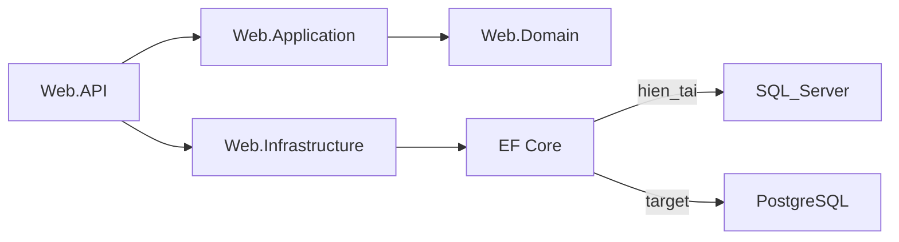

# Kế hoạch: PostgreSQL + Docker (Dokploy)

**Quyết định đã chốt:** Data = option C (giữ schema EF + seed một phần, không migrate full production). Azure Blob tạm **giữ nguyên** (chỉ đổi DB + host). .NET 10 để phase sau (đúng `[WORKFLOW.md](d:\Projects\SF\workspace\docs\WORKFLOW.md)`).

---

## 1) Backend: switch SQL Server → PostgreSQLl

### Kết luận

**Có thể switch.** Kiến trúc Clean Architecture hiện tại (Domain/Application không gắn SQL Server; chỉ Infrastructure gọi EF) phù hợp đổi provider. App code hầu hết dùng LINQ/repositories — không có `FromSqlRaw` trong runtime.

Điểm gắn SQL Server cần đổi:


| Chỗ         | File                                                                                                                     | Việc                                                                                                                                                      |
| ----------- | ------------------------------------------------------------------------------------------------------------------------ | --------------------------------------------------------------------------------------------------------------------------------------------------------- |
| Package     | `[Web.Infrastructure.csproj](d:\Projects\SF\SFBE\src\Web.Infrastructure\Web.Infrastructure.csproj)`                      | `EF.SqlServer` → `Npgsql.EntityFrameworkCore.PostgreSQL` (cùng major EF 8)                                                                                |
| Provider    | `[ServiceCollectionExtensions.cs](d:\Projects\SF\SFBE\src\Web.Infrastructure\Extensions\ServiceCollectionExtensions.cs)` | `UseSqlServer` → `UseNpgsql`                                                                                                                              |
| Conn string | `appsettings` / env                                                                                                      | Format Postgres: `Host=...;Port=5432;Database=...;Username=...;Password=...` (giữ tên key `CentimilDB`)                                                   |
| Migrations  | `Web.Infrastructure/Migrations/`                                                                                         | **Xóa lịch sử SQL Server**, tạo migration Postgres mới từ model hiện tại (vì option C + 26 migration gắn `SqlServer:Identity` / `nvarchar` / raw `TOP 1`) |
| Seeder      | `[RestaurantSeeder.cs](d:\Projects\SF\SFBE\src\Web.Infrastructure\Seeders\RestaurantSeeder.cs)`                          | Giữ `MigrateAsync()`; thu hẹp seed (roles + admin + settings cần thiết; bỏ/không phụ thuộc script T-SQL trong `assets/`)                                  |
| Secrets     | Hiện nằm trong `appsettings.Development.json`                                                                            | Production: env vars (`ConnectionStrings__CentimilDB`, `JWT__`*, …) — không commit secrets                                                                |





### Khác biệt đáng chú ý (query / schema / perf)

**Schema / types (EF map giúp phần lớn):**

- `nvarchar` / `datetime2` / `bit` → Postgres `text`/`varchar`, `timestamp`, `boolean`
- Identity: SQL Server `IDENTITY` → Postgres `GENERATED BY DEFAULT AS IDENTITY` / sequence (EF Npgsql lo khi tạo migration mới)
- Tên bảng/cột: Postgres case-sensitive nếu quoted; EF thường quote — **đừng viết raw SQL kiểu SQL Server** (`[dbo].`, `TOP`, `IDENTITY_INSERT`)
- Script `[assets/INSERT Restaurants.sql](d:\Projects\SF\SFBE\assets\INSERT%20Restaurants.sql)` **không dùng được** trên Postgres

**Query / hành vi:**

- So sánh chuỗi: Postgres **case-sensitive** mặc định (`'A' <> 'a'`); SQL Server collation thường không. Ảnh hưởng search/filter nếu có so sánh text thủ công
- `LIKE` vs cần `ILIKE` cho search không phân biệt hoa thường (nếu FE/BE expect case-insensitive)
- Boolean: Postgres true `boolean`, không dùng `0/1` như bit trong raw SQL
- Không có `NOLOCK` / hint T-SQL — không vấn đề vì app không dùng

**Performance (thực tế với app này):**

- Với LINQ + volume vừa, **ít khác** nếu index giữ đúng (PK/FK EF tạo lại)
- Npgsql có connection pooling tốt — phù hợp Docker
- Cần kiểm tra lại query nặng (instrument/filter) sau switch bằng log EF / `EXPLAIN` nếu chậm; không expect rewrite lớn ngay

**Cách làm an toàn với option C:**

1. Local: chạy Postgres (Docker)
2. Đổi package + `UseNpgsql` + connection string
3. Xóa folder Migrations cũ → `dotnet ef migrations add InitialPostgres`
4. Chạy API → `MigrateAsync` tạo schema
5. Chỉnh seeder: roles + user admin + settings/endpoint mappings tối thiểu
6. Smoke test Swagger (identity, instruments, settings)
7. Không cần tool migrate data SQL Server → Postgres

**Chưa làm trong phase này:** nâng .NET 10, đổi Azure Blob, xóa module Restaurant legacy (có thể làm sau).

---

## 2) Docker: BE / FE / DB — cách làm cho người mới

### Nguyên tắc

- **Mỗi service một Dockerfile** (BE image riêng, FE image riêng). Dễ build, dễ deploy Dokploy.
- **Một `docker-compose.yml` cho local** gom Postgres + API (+ optional FE) để `docker compose up` học và test.
- **Trên Dokploy:** thường tạo **nhiều application/service** (postgres managed hoặc compose stack). Compose local ≠ bắt buộc giống 1:1 production, nhưng cùng Dockerfile thì tái sử dụng được.

### Đề xuất cấu trúc file

```text
SFBE/
  Dockerfile                 # build Web.API
  .dockerignore
  docker-compose.yml         # local: api + postgres (khuyến nghị đặt ở BE hoặc workspace)
SFFE/
  Dockerfile                 # multi-stage: npm build → nginx serve build/
  nginx.conf                 # SPA fallback → index.html
  .dockerignore
workspace/                   # optional: compose fullstack trỏ cả BE+FE+db
```

**Vì sao không “một Dockerfile cho cả BE+FE”:** image phình to, restart FE kéo theo API, Dokploy khó scale/log riêng. Compose **ghép** nhiều container — đó là “chung 1 file điều phối”, không phải chung 1 image.

### Config / secrets (quan trọng)


| Môi trường   | Cách                                                                                                                   |
| ------------ | ---------------------------------------------------------------------------------------------------------------------- |
| Local Docker | file `.env` (gitignored) cạnh compose; compose inject vào container                                                    |
| Dokploy      | UI Environment Variables / Secrets — **không** nhét secret vào image                                                   |
| FE           | `VITE_*` phải có **lúc `npm run build`** (build-arg). Sai = phải rebuild                                               |
| BE           | đọc env runtime: `ConnectionStrings__CentimilDB`, `ASPNETCORE_URLS=http://+:8080`, `ASPNETCORE_ENVIRONMENT=Production` |


Ví dụ mapping compose (ý tưởng):

- Service `db`: image `postgres:16`, volume `pgdata`, port `5432`
- Service `api`: build từ `SFBE/Dockerfile`, depends_on `db`, env connection string `Host=db;...`
- Service `web` (optional local): build `SFFE`, nginx port 80, `VITE_API_PREFIX` trỏ URL public API

**CORS:** hiện có `AllowOrigin` + TODO “remove when deploy” trong `[WebApplicationBuilderExtensions.cs](d:\Projects\SF\SFBE\src\Web.API\Extensions\WebApplicationBuilderExtensions.cs)` — production phải set origin đúng domain FE (HTTPS), không xóa CORS khi FE/API khác origin.

### Dokploy trên Hostinger (phase sau Docker local)

1. VPS Hostinger + cài Dokploy
2. Postgres: service/database trong Dokploy (hoặc container trong stack)
3. Deploy BE từ Dockerfile + env secrets
4. Deploy FE (nginx static) + build-arg `VITE_API_PREFIX=https://api.yourdomain/`
5. Domain + SSL (Dokploy/Traefik)
6. Google OAuth: thêm authorized JS origin domain FE mới

---

## 3) Thứ tự làm (từng phần)


| Phase                  | Mục tiêu                                                | Done khi                                                 |
| ---------------------- | ------------------------------------------------------- | -------------------------------------------------------- |
| **A — Postgres local** | Đổi provider, migration mới, seed tối thiểu             | `dotnet run` + Swagger OK trên Postgres local            |
| **B — Docker local**   | Dockerfile BE + compose `api+db`; Dockerfile FE + nginx | `docker compose up` chạy được API; FE build/serve được   |
| **C — Config sạch**    | Secrets qua env; CORS + `.env.example` cập nhật         | Không phụ thuộc `appsettings.Development.json` trên prod |
| **D — Dokploy**        | Deploy Hostinger                                        | HTTPS FE↔API, login JWT/Google OK                        |
| **E — (sau)**          | .NET 10, tối ưu Blob/nginx, dọn Restaurant legacy       | Theo roadmap WORKFLOW                                    |


---

## Phạm vi phase A (khi bạn bảo implement)

Chỉ BE:

- Npgsql + `UseNpgsql`
- Reset migrations → `InitialPostgres`
- Seeder tối thiểu (roles + admin + settings cần thiết — danh sách seed cụ thể chốt lúc implement dựa trên `RestaurantSeeder` hiện có)
- Hướng dẫn chạy Postgres local (compose nhỏ hoặc Docker một container)
- Cập nhật `[ARCHITECTURE.md](d:\Projects\SF\workspace\docs\ARCHITECTURE.md)` / note trong WORKFLOW phase 2

Chưa đụng FE production URL, Dokploy, hay .NET 10 trong phase A.